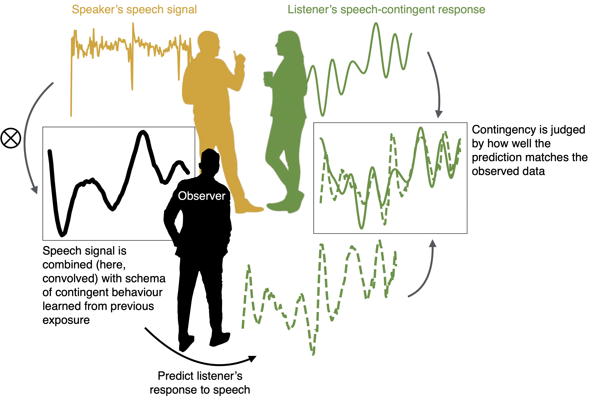
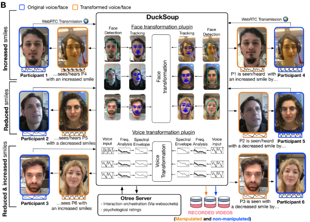
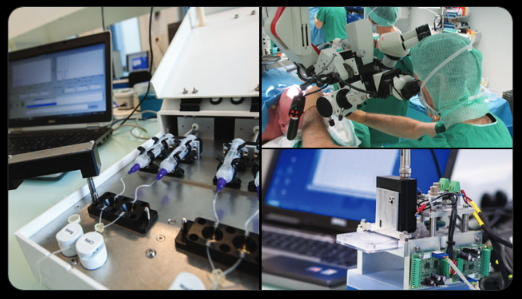

### Postdoc position: System identification in video conversations with real-time face manipulation filters

*Application deadline:* Dec 31, 2026. Applications reviewed on a rolling basis. 
*Start date:* Feb-March 2027, no longer than June 2027.   

The [Femto Neuro group](https://neuro-team-femto.github.io), Dept. of Automation and Robotics, [FEMTO-ST Institute](https://www.femto-st.fr) in Besançon, France is seeking applications for a 18-month Postdoctoral position applying Control Engineering to an exciting new domain of video conversations augmented with real-time face manipulation filters. The position will be co-supervised by a control engineering professor and a cognitive science researcher, ensuring strong grounding in rigorous control methodology alongside the domain expertise needed to design and interpret the experiments. 
 
The position is based in Besançon, France and is funded by [PEPR eNSEMBLE](https://www.pepr-ensemble.fr/) project called COFFEE (Collaborative Filters: Exploring the Impact of Augmented-Reality Filters on Digital Collaboration), which gathers a consortium of several engineering, cognitive science and humanities-and-social-science laboratories in Besançon, Grenoble, Rennes and Paris. 

#### The science

Human social interactions display a complex choreography of dynamic, non-verbal facial expressions such as smiles, nods and blinks ([Holler et al. 2022](https://pmc.ncbi.nlm.nih.gov/articles/PMC9310176/)). A wealth of psychological research has investigated, for example, the typical delay with which speakers smile back in response to a smile ([Truong, 2011](https://www.isca-archive.org/interspeech_2011/truong11_interspeech.html)) and how it may depend on culture or context  ([White, 1989](https://www.cambridge.org/core/journals/language-in-society/article/abs/backchannels-across-cultures-a-study-of-americans-and-japanese1/B26AC3C44C237B9A380A5494EA5693ED)). 

From a control engineering point of view, understanding the coupling between the facial expressions of two people in a conversation is a system identification problem: the temporal signal of speaker A's speech or facial expression is the input, the temporal signal of speaker B's facial reaction is the output, and we seek a transfer-function description of the system that maps one to the other. In our recent work, we showed that impulse responses, despite assuming linearity and time-invariance, already capture important aspects of facial-expression coupling in conversations ([Guha et al, 2026](https://neuro-team-femto.github.io/articles/2026/guha_openmind_2026.pdf)). In particular, the prediction error between B's actual facial response and the response predicted from A's signal by an identified impulse response correlates with independent observers' ratings of how genuine the conversation appears.

A fundamental limitation of applying system identification to human interaction is that a conversation is hard to study as an experimental plant: one cannot easily inject a "smile" step input, or nod/blink white noise, into a natural conversation. One is typically limited to pre-recorded datasets in which the input behaviour is not controlled, which makes the identification of system dynamics unreliable.

This project removes that limitation. We recently developed Ducksoup, an online video-conferencing platform equipped with real-time facial-manipulation filters whose parameters can be controlled experimentally. In a recent study, we used it to filter both participants of a conversation to appear either smiling or neutral; conversations in which both participants saw themselves smiling were rated more enjoyable, and participants reported liking each other better ([Arias et al., 2024](https://neuro-team-femto.github.io/articles/2024/arias_pnas_2024.pdf)). All experiments are conducted under full ethics-board approval, with informed consent, debriefing, and GDPR-compliant data handling. This means that the input to the "plant" is designed, controlled, and reproducible, exactly as in a robotics lab, but with a human in the loop and the ability to run large-scale online experiments.

With the ability to collect large datasets of human conversations in which, for example, a participant's apparent smile is experimentally controlled, we can now apply the full methodological toolbox of system identification to a completely novel experimental system. This postdoctoral position aims to do exactly that:
1. *Build and release the SMILE benchmark:* a large dataset of dyadic video-conferenced conversations with experimentally controlled facial feedback, published as a benchmark for the system identification community.
2. *Identify the dynamics of human smile coupling:* apply state-of-the-art data-driven system identification techniques (e.g. subspace methods, kernel and regularized approaches, port-Hamiltonian approaches) to the dataset, and characterize key properties of human facial-response dynamics as transfer functions and impulse responses.
3. *Close the loop:* use the identified transfer function to design and implement real-time control strategies — e.g. model predictive control — acting on the conversation through the platform's parametric filters.

This project offers an unusual combination for a control engineer: a genuinely novel, instrumented experimental plant (online, scalable, and controllable in real time), together with a rigorous, quantitative methodology. The experimental discipline is the same as in robotics (designed inputs, measured outputs, reproducible protocols), applied to a [human-in-the-loop system](https://gds2026.gdr-macs.fr/node/1). Expected outcomes are publications in top control venues (CDC, IFAC, Automatica, IEEE TAC) as well as high-impact interdisciplinary journals (PNAS, Nature Communications), together with a reusable, citable benchmark dataset. In short, a strong foundation for an independent research career at the intersection of control engineering and cognitive science.

#### The environment

The project is based in the [Femto Neuro group](https://neuro-team-femto.github.io), [FEMTO-ST Institute](https://www.femto-st.fr) in Besançon, France. The position will be co-supervised in FEMTO by Dr [Jean-Julien Aucouturier](https://neuro-team-femto.github.io/people/jj_aucouturier/) (Directeur de recherche CNRS, Cognitive Science) and Prof. [Karim Cherifi](https://scholar.google.com/citations?user=gE5RRyEAAAAJ&hl=en) (Junior Professor Supmicrotech, Control Engineering). The position will also enable multiple interactions with other members of the COFFEE consortium, including Ducksoup's main developper [Pablo Arias-Sarah](https://pablo-arias.github.io/) (Chargé de recherche CNRS, LPNC, Grenoble). 

{:style="float: left;margin-right: 12px;margin-top: 7px;" width="30%"} With more than 750 researchers, the [FEMTO-ST Institute](https://www.femto-st.fr) (CNRS/Université de Bourgogne Franche-Comté) is the region's largest engineering CNRS lab, with expertise covering all fields of system science. The neuro group is based in FEMTO's [Department of Automation and Robotics](https://www.femto-st.fr/en/Research-departments/AS2M/Presentation), which hosts about 80 researchers active in the fields of robotics, mechatronics, automatic control and artificial intelligence.  

{:style="float: left;margin-right: 12px;margin-top: 7px;" width="30%"} A world-heritage UNESCO site close to the French-Swiss mountains of Jura, [Besançon](https://boosteurdebonheur.besancon.fr/) is a vibrant, mid-size regional capital city regularly ranking best-in-France for its [quality of life](https://paris-jetequitte.com/partir-vivre-besancon/) and surface green spaces per inhabitant, but also boasts a newly-federated university ([Université Marie et Louis Pasteur](https://fr.wikipedia.org/wiki/Universit%C3%A9_Marie-et-Louis-Pasteur)) of more than 50k students.  

#### Applicants

The ideal applicant holds a PhD in control engineering or a closely related field, with a background in data-driven system identification and strong programming skills (Python or MATLAB). Familiarity with machine learning, statistical modelling, and audiovisual signal processing (speech, image, video) is an asset but not a requirement. No prior experience in psychology or cognitive science is required (the necessary domain context is provided) but an interest in interdisciplinarity and a curiosity for the science of human interaction are essential. The position also involves designing and running experiments with human participants under ethics-board approval, so an experimental mindset and good organisational skills are valued. A good command of English (written and spoken) is required; French is a plus.

#### How to apply:

Shortlisted candidates will be invited for an interview in January 2027.

*Application material:*
- curriculum vitae, including publication list
- motivation letter detailing past experiences relevant to the project (see above)
- names of 2 referees who can provide reference letters if requested

The successful applicant will be hired on a CNRS postdoctoral researcher contract, with salary in accordance with CNRS pay scales: for junior postdocs (0–2 years of experience), gross monthly salary generally starts around €2,800–€3,700 (roughly €2,100–€3,000 net); for more experienced postdocs (2+ years), gross monthly salary is about €3,700–€4,750 (roughly €3,100–€3,550 net). These salary figures are provided for guidance only and are indicative; they do not constitute a commitment and are subject to the CNRS pay grid in force at the date of hiring.

For informal enquiries and to apply, please contact:
Jean-Julien Aucouturier ([jean.aucouturier@femto-st.fr](mailto:jean.aucouturier@femto-st.fr)). 

